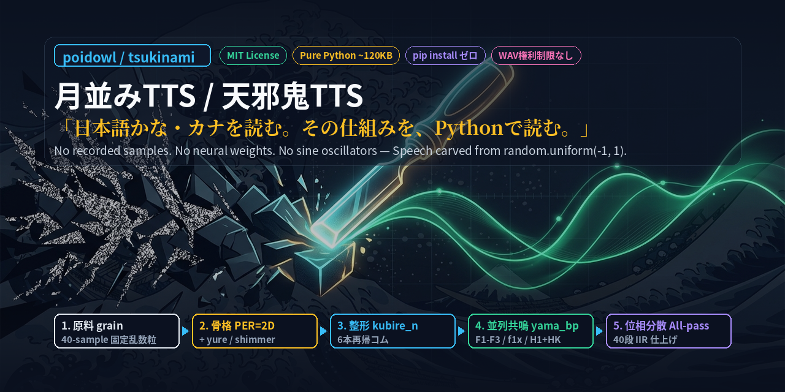

# 月並みTTS / 天邪鬼TTS (`tsukinami`)



**[🇯🇵 日本語](README.md) | [🌐 English (README_EN.md)](README_EN.md)**

> **日本語かな・カナを読む。**  
> **その仕組みを、Pythonで読む。**

> **「声を描く」のではなく、「声が生まれる条件を作る」。**  
> **声のサンプルを持たない。学習済み音声モデルも持たない。乱数から声を削り出す。**

### 👉 今すぐブラウザで鳴らす・いじる（Live Demo — スマホ・PC対応・インストール不要）
- 🎛️ **[みんなのオモチャ箱 (`toybox.html`)](https://poidowl.github.io/tsukinami/toybox.html)** — 実機 `carve.py` の6キャラ声プリセット ＋ 壊す前の音とのA/B比較 ＋ 10急所スライダー ＋ レシピJSON共有
- 🔬 **[6段階彫刻＆17拍断面スコープ (`watashi_demo.html`)](https://poidowl.github.io/tsukinami/watashi_demo.html)** — 「わたし、にほんご、ちょっとしゃべれます」が雑音から声になる全工程を聴く
- 🧪 **[7種アブレーション聴き比べ (`ablation.html`)](https://poidowl.github.io/tsukinami/ablation.html)** — 部品（40粒の芋判・揺らぎ・H1・オールパス等）を1つずつ抜いた音を比較
- 🎹 **[自由かな入力シンセ (`demo.html`)](https://poidowl.github.io/tsukinami/demo.html)** — 好きなひらがな・カタカナを入力してその場で合成

---

**月並みTTS / 天邪鬼TTS** は、録音データ（波形接続）も学習済み重み（ニューラルTTS）も、さらにはサイン波やパルス列といった既製の周期波形も使わず、**1回生成の固定乱数粒（`grain`＝芋判）を周期配置（`PER=2D + yure + shimmer`）し、並列共鳴バンクで各帯域を抽出・再合成して、全域通過フィルタで位相・時間分散を整える**、約120KBのピュアPython音声合成器です（第1段はPython標準ライブラリのみで動作し、`henv=null` の [`S.txt`](S.txt) / [`mkt.py`](mkt.py) 設定ではFFT処理を通らず第1段のみで完結します）。

- **コードのライセンス**: **MIT License**（[LICENSE](LICENSE)）— 商用・非商用・改変・再配布すべて自由（「もってけドロボー」方式）。
- **生成した音声（WAV）の権利**: **クレジット表記を含め一切の制限なし**。動画・配信・ゲーム・アプリ・商用作品に無表記でそのまま使えます。
- **外部データ・外部ライブラリ依存（第1段）**: **ゼロ**。Windows / macOS / Linux の Python 3 標準ライブラリだけで動作します。

---

## 最終アーキテクチャ図（実コード監査・アブレーション検証済）

```text
[1回生成の40サンプル乱数 grain] ──▶ [周期配置 (PER=2D + yure + shimmer)] ──▶ [kubire_n (倍音整形)] ＋ [息成分]
        (固定スペクトル＝声色DNA)             (時間・振幅の揺らぎと骨格)
                                                                                       │
        ┌──────────────────┬──────────────────┬──────────────────┬─────────────────────┤
        ▼                  ▼                  ▼                  ▼                     ▼
  [母音 F1・F2・F3]    [F1の肩 (f1x)]     [基音 H1・倍音 HK]     [F4・F5]            (並列抽出)
        └──────────────────┴──────────────────┴──────────────────┴─────────────────────┘
                                               │
                                               ▼ (加算再合成 mix)
                                   [All-pass 40段 (位相・時間分散の仕上げ)]
```

### 技術解説：5つの役割分担（[`carve.py:994-1117`](carve.py#L994-L1117)）

1. **原料（固定スペクトル粒 `grain` — [`carve.py:995-999`](carve.py#L995-L999)）：**
   乱数から一度だけ削り出した40サンプル（約0.91 ms @ 44.1 kHz）の音響素材を声色の核（固定スペクトル＝声色DNA）として再利用します。2サンプルの衝撃波へ置き換えると短時間スペクトル距離で **16.59 dB** の差が生じる、音色の個性を決める最重要パーツです。
2. **骨格（`PER = 2D` ＋ `yure` ＋ `shimmer` — [`carve.py:976-1005`](carve.py#L976-L1005)）：**
   固定の `grain` を基本周期 `PER = 2D` で時間軸上に配置しつつ、配置間隔に微細な時間揺らぎ（`yure = 0.003` 等）、配置ごとに振幅揺らぎ（`shimmer = 0.05`）を与えます。揺らぎ系をすべてゼロにすると **10.51 dB** 変化します。
3. **倍音整形（`kubire_n` — [`carve.py:92-102`](carve.py#L92-L102), [`1007-1009`](carve.py#L1007-L1009)）：**
   再帰型コムフィルタによって倍音構造を微調整します（話し声本線では `K75: N=4, g=0.3` / `E77・E79・mkt.py: N=6, g=0.5`）。現行パラメータでは除去時も波形相関係数 $r = +0.9971$（短時間LSD 4.39 dB、長時間帯域スペクトル差 1.34 dB）と高い一致率を示し、周期配置と後段の並列共鳴抽出だけでも主要な音響構造が成立していることが実証されています。
4. **共鳴の再構成（並列抽出・加算再合成 — [`carve.py:1038-1104`](carve.py#L1038-L1104)）：**
   音源に無声子音の息成分（`hiss`）を合わせた `src` に対し、直列にフィルタを通すのではなく、床（`floor`）、母音フォルマント（$F_1\text{–}F_3$）、$F_1$ の肩（`f1x`）、基音 $H_1$、高次倍音 $H_K$（$2H, 3H$）、高域フォルマント（$F_4, F_5$）をそれぞれ [`yama_bp`](carve.py#L136-L145)（`g = 0.7` / `0.5`）と短区間 [`_agc`](carve.py#L519-L523) で**並列に分岐抽出**してから `mix` に加算再合成します。
5. **位相・時間方向の仕上げ（All-pass 40段 — [`carve.py:553-570`](carve.py#L553-L570), [`1109`](carve.py#L1109)）：**
   周波数成分を削るのではなく、2次IIR全域通過フィルタ（`_ap_cascade`）40段によって位相回転と時間方向の群遅延分散を付与し、質感を整えます（定常振幅特性 $|H(e^{j\omega})|=1$ のため、発話全体の長時間帯域スペクトル差は **0.07 dB** と不変である一方、群遅延分散により波形相関は $r = -0.0838$、20 ms短時間窓のLSDは **4.24 dB** 変化します）。

---

## アブレーション（部品引き抜き）定量検証結果（[`ablation.html`](ablation.html)）

テスト文：`「わたし、にほんご、ちょっとしゃべれます」`（`yomu2.sh` 第1段：`mkt.py` + `S.txt` + `OO.txt`, `seed=2024`, 44.1 kHz, 4.355秒）

| 実験条件（[`ablation.html`](ablation.html) で試聴可能） | 波形相関係数 $r$ | 短時間LSD (20ms窓) | 長時間帯域スペクトル差 | 解釈・聴感上の変化 |
|---|---:|---:|---:|---|
| **① 基準（フル装備）** | `+1.0000` | `0.00 dB` | `0.00 dB` | 第1段の標準出力 |
| **② `grain` を2サンプル衝撃波 `[1,-1]` に置換** | `-0.6427` | **`16.59 dB`** | **`8.42 dB`** | 声色の核が失われ「ジーッ」という機械ブザー音に激変 |
| **③ 周期の揺らぎ系（`yure`/`shimmer`/`tadayoi`）全除去** | `+0.1014` | **`10.51 dB`** | `1.89 dB` | 位相軌道が固定され、硬직したロボット声に変化 |
| **④ 基音 `H1` ＋ 倍音 `HK`（`2H, 3H`）を単独除去** | `+0.9027` | **`5.11 dB`** | **`3.87 dB`** | 低〜中域の胸の響きが抜け、細く軽い声に変化 |
| **⑤ `F1` の肩（`f1x`）を単独除去** | `+0.9974` | **`1.02 dB`** | `0.55 dB` | $F_1\text{–}F_2$ 間の谷を埋める約1 dB（最小可聴差レベル）の微調整 |
| **⑥（参考）`F1` の肩 ＋ `H1/HK` を同時除去** | `+0.8827` | `5.58 dB` | `4.12 dB` | ④（`5.11 dB`）が主寄与、⑤（`1.02 dB`）が補助寄与と分離確定 |
| **⑦ 音源の6本くびれ（`kubire_n`）を除去 (`line_g=0`)** | **`+0.9971`** | `4.39 dB` | `1.34 dB` | 周期配置と並列抽出だけで主要な声構造がほぼそのまま残る |
| **⑧ 仕上げの40段オールパス（`_ap_cascade`）を除去 (`ap_n=0`)** | `-0.0838` | `4.24 dB` | **`0.07 dB`** | 長時間周波数振幅は不変（`0.07 dB`）のまま位相・時間分散のみ変化 |

> **定量指標の算出定義**：
> - **波形相関係数 $r$**：44.1 kHz 全サンプル列 $x_{\text{ref}}, x_{\text{test}}$ 間のピアソン相関係数 $\frac{\sum (x_{\text{ref}}-\bar{x}_{\text{ref}})(x_{\text{test}}-\bar{x}_{\text{test}})}{\sqrt{\sum(x_{\text{ref}}-\bar{x}_{\text{ref}})^2 \sum(x_{\text{test}}-\bar{x}_{\text{test}})^2}}$。
> - **短時間対数スペクトル距離（LSD 20ms窓）**：窓長 20 ms（882サンプル Hanning窓）、フレームシフト 10 ms（441サンプル）、有声区間（フレーム平均パワー $> 10^{-5}$）における $\text{LSD} = \frac{1}{|T|}\sum_{t \in T}\sqrt{\frac{1}{K}\sum_{k=0}^{K-1}\left(20\log_{10}\frac{|X_{\text{ref}}(t,k)| + 10^{-7}}{|X_{\text{test}}(t,k)| + 10^{-7}}\right)^2}$。20 ms を超える群遅延分散（オールパス等）も短時間フレーム間のエネルギー移動として検出します。
> - **長時間帯域スペクトル差**：発話全体のFFT振幅スペクトルを 100 Hz〜8,000 Hz の 100 Hz 幅バンドごとにRMS集計した対数差の二乗平均平方根（位相回転・時間シフトに不変な純粋な周波数振幅差）。

---

## 0. Pythonなしで今すぐブラウザで聴く・触る（4つの同梱HTMLデモ）

すべて外部CDN通信なし・単一HTMLファイルで動作します：
1. **[`toybox.html`](toybox.html)**：**壊しても戻せる「月並みTTS みんなのオモチャ箱」（実機 `carve.py` 6キャラプリセット ＋ A/B比較 ＋ 10急所スライダー ＋ レシピJSON共有）**
2. **[`watashi_demo.html`](watashi_demo.html)**：**「わたし、にほんご、ちょっとしゃべれます」6段階彫刻＆17拍断面スコープ＆7種アブレーション完全解剖デモ**（実機 `carve.py` 音声内蔵）
3. **[`ablation.html`](ablation.html)**：**部品引き抜き（アブレーション）全7トラック聴き比べ＆定量指標テーブル**
4. **[`demo.html`](demo.html)**：**自由かな入力シンセサイザー＆行番号直結スライダー**

---

## なぜ「765個の数値」で日本語を喋れるのか？（問題の絞り込みと3層の設計）

> **「人間の声を丸ごと再現する」という問題を解いたのではなく、「人間（およびASR）が日本語の声として認識するための音響的な手掛かり（acoustic cues）を、かな列から作る」という問題に絞った。**
> —— 人間の声を丸ごと作ろうとしなくても、「日本語をしゃべっていると認識できる音」は、思ったより少ない仕掛けで作れた。

現代のニューラルTTSが数千万〜数億個の重みパラメータで音声波形全体を統計モデル化するのに対し、本エンジンの数値定数は **合計 765個**（設定辞書 **418個** ＋ 関数内リテラル定数 **347個**）です。この規模で成立している理由は、以下の3つの設計上の絞り込みにあります：

1. **入力を「かな列」に絞り、古典音声学の知見とASRで調音・韻律の手掛かりを固めた（[`kotoba.py:1-76`](kotoba.py#L1-L76), [`accent.py:1-26`](accent.py#L1-L26) — 計 `187個`）：**
   - かな表記を入力とすることで漢字の読み分け（G2P）を切り離し、5母音の目標フォルマント `VT`（`5×3 = 15個`）を起点に据えています。
   - そのうえで、CVだけでなく子音の調音位置・方法、$F_2$ ローカス方程式（`LE`）、子音長（`CDUR`）、鼻音（`nasT`）、促音（`ッ`）・撥音（`ン`）、無声化関連の減衰、摩擦音帯域（`fricT`）といった音響音声学の教科書的知見（`TEXTBOOK`）を実装し、さらに人間の耳と音声認識器（`owner ear + ASR`、[`kotoba.py:5`](kotoba.py#L5)）を指標にして子音キューやスケーリング係数を絞り込んでいます。
2. **単純な乱数素材を、多段の音源加工で「声らしい励振源」に整えた（[`carve.py:985-1027`](carve.py#L985-L1027), [`yomu.py:28-39`](yomu.py#L28-L39)）：**
   - 40サンプルの固定乱数粒（`grain`）を周期配置（`PER = 2D`）するだけでなく、周期ごとの時間ゆらぎ（`yure = 0.003`）、粒ごとの振幅ゆらぎ（`shimmer = ±5%`）、ゆっくりしたピッチの漂い（`tadayoi`）を加え、さらに6本くびれ（`kubire_n`）と古い声の線のブレンドで倍音を整え、有声音と無声子音ノイズ（`hiss`）を混合して共鳴バンクへ送っています。
3. **共通音源からの並列分岐抽出と加算で、帯域ごとの手掛かりを構成した（[`carve.py:1038-1109`](carve.py#L1038-L1109) — レシピ `231個` ＋ 関数内 `347個`）：**
   - フォルマント合成におけるカスケード／並列構成自体は Klatt (1980) 以来の伝統ですが、[`carve.py`](carve.py) では共通の音源 `src` から床（`floor`）・母音 $F_1\text{–}F_3$・$F_1$ の肩（`f1x`）・基音 $H_1$／倍音 $H_K$・高域 $F_4\text{–}F_5$ を時間領域の移動平均バンドパス（`yama_bp`）と短区間AGC（`_agc`）で並列に削り出して加算し、最後に40段オールパス（`_ap_cascade`）で位相・群遅延を分散させています（共通音源を共有し加算時に干渉するため完全独立ではありませんが、各帯域の手掛かりを見通しよく調整できる構造になっています）。

### 📚 先行研究（古典音声学・DSPの定石）と本プロジェクト独自の工夫の切り分け

「LLMを通じて取り入れた先行研究の知見」と「本プロジェクト独自の設計・実装」の境界は以下の通りです（第三者のコード転載はなく、すべてPython標準ライブラリのみでゼロから実装しています）：

| 区分 | 項目 | 対応箇所 | 出典・背景 |
|---|---|---|---|
| **📚 先行研究・教科書の知見**<br>*(Classical Literature)* | カスケード／並列フォルマント合成の枠組みと母音・子音目標値 | [`kotoba.py:53-76`](kotoba.py#L53-L76)<br>[`carve.py:1038-1100`](carve.py#L1038-L1100) | Dennis H. Klatt (1980), *"Software for a cascade/parallel formant synthesizer"*, JASA 67(3), pp. 971–995. |
| **📚 先行研究・教科書の知見** | 子音→母音遷移の $F_2$ ローカス方程式 (`LE`) | [`kotoba.py:67, 174`](kotoba.py#L67) | Björn Lindblom (1963) / Harvey M. Sussman et al. (1991), *JASA* 90(3). |
| **📚 先行研究・教科書の知見** | 東京式アクセント規則・ダウンステップ・自然下降 | [`accent.py:9-26`](accent.py#L9-L26) | Janet Pierrehumbert & Mary E. Beckman (1988), *"Japanese Tone Structure"*, MIT Press / 藤崎モデル (Fujisaki model). |
| **📚 先行研究・教科書の知見** | スペクトル包絡のガウス山・傾斜エネルギー診断 (`_world_energy`) | [`carve.py:495-517`](carve.py#L495-L517) | Masanori Morise et al. (2016), *"WORLD: A Vocoder-Based High-Quality Speech Synthesis System"*, IEICE Trans. |
| **📚 先行研究・教科書の知見** | 2次IIR全域通過フィルタ（Biquad All-Pass）による群遅延分散 | [`carve.py:553-570`](carve.py#L553-L570) | 古典DSPの標準2次All-Passセクション（カスケード40段で時間分散を付与）。 |
| **🪵 本プロジェクト独自の工夫**<br>*(Original to Tsukinami)* | **「40サンプルの固定乱数粒（芋判 `grain`）」の1回切り出しと周期スタンプ** | [`carve.py:995-1005`](carve.py#L995-L1005) | パルス列や正弦波を使わず、白色雑音を移動平均で粗削りした40サンプルの固定乱数粒1個を「声色のDNA」として毎周期（`PER=2D + yure + shimmer`）スタンプする方式。 |
| **🪵 本プロジェクト独自の工夫** | **移動平均の引き算と前後コムによる時間領域ノミ群 (`arakezuri`, `kubire_n`, `yama_bp`)** | [`carve.py:18-145`](carve.py#L18-L145) | 移動平均の引き算と時間遅延フィードバック（$N$本くびれ・ゼロ位相前後コム `_ffbb`）だけで音源整形からフォルマント抽出までを一貫して「削り出す」実装。 |
| **🪵 本プロジェクト独自の工夫** | **歌唱ビブラート波の「乱数削り出し」生成 (`uta_vib`)** | [`carve.py:961-973`](carve.py#L961-L973) | ビブラートの揺れすら `math.sin()` を使わず、白色雑音をコムフィルタと移動平均で削り出して周期波を作る天邪鬼設計。 |
| **🪵 本プロジェクト独自の工夫** | **人間の聴感（「ほわん」「カキン」等の擬音ダメ出し）× ASR自動審判 × LLMの対話による765定数の凝縮** | [`kotoba.py:225-245`](kotoba.py#L225-L245)<br>[`carve.py:1-11, 391-479`](carve.py#L1-L11) | 外部ライブラリ・外部コーパスゼロの純Python（約120KB）に全765個の定数を凝縮し、`--compare` / `--recipe` / `toybox.html` で誰でも壊して戻せるオモチャ箱化。 |

---

## 1. コア構成とファイルサイズ（第1段：かな→WAV合成＋歌声合成）

第1段の合成エンジン本体は、日本語コメント付きの素のPythonファイル3本（合計 **120,345 bytes ≒ 117.5 KB**、設定スクリプト [`mkt.py`](mkt.py) 等を含めて **123,129 bytes ≒ 120.2 KB**）で完結しています。

| ファイル | サイズ | 役割 |
|---|---|---|
| [`kotoba.py`](kotoba.py) | 20,626 B | 日本語のかな文字列から5msごとの母音フォルマント軌道（`F1`〜`F3`）・子音遷移（ローカス方程式）・音量軌道・子音ノイズ帯（`bands`）を計算 |
| [`accent.py`](accent.py) | 12,784 B | 辞書なしの東京式アクセント規則モデル（句頭上昇・核落下・ダウンステップ・自然下降・疑問文上昇）から5msごとの基本周波数軌道（`f0`）を計算 |
| [`carve.py`](carve.py) | 86,935 B | 固定乱数粒 `grain`・周期配置（`PER=2D + yure + shimmer`）・再帰コム（`kubire_n`）・並列共鳴バンク（`yama_bp`）・AGC・40段オールパス（`_ap_cascade`）でWAVを書き出す本体 |
| [`mkt.py`](mkt.py) + [`S.txt`](S.txt) + [`OO.txt`](OO.txt) | 2,784 B | コマンドライン（[`yomu2.sh`](yomu2.sh)）から設定JSONを組み立てて [`carve.py`](carve.py) を呼ぶドライバ |

---

## 2. 使い方：「壊しても戻せるTTS」（Play → Modify → Listen → Compare → Share）

Windows / macOS / Linux すべてで `python`（または `python3`）だけで動き、**いじる → 鳴らす → 元の音と比べる → レシピを共有する**サイクルが1コマンドで回せます：

```bash
# 1) 【Play】そのまま喋らせる（out/yomu_1.wav に出力）
python yomu.py "わたし、にほんご、ちょっとしゃべれます"

# 2) 【Preset】同梱のキャラ声プリセットで遊んでみる（おっさん / ロボ / ホラーNPC / ささやき / ちびっ子 / ソプラノ彫刻家 / 4共鳴腔オペラ歌姫）
python yomu.py --list-presets
python yomu.py --preset ossan   "わたし、にほんご、ちょっとしゃべれます"
python yomu.py --preset horror  "うしろに、だれか、いますよ"
python yomu.py --preset robot   "わたし、にほんご、ちょっとしゃべれます"
python yomu.py --preset whisper "ないしょの、おはなしですよ"
python yomu.py --trance         "わたし、にほんご、ちょっとしゃべれます"
python yomu.py --choir          "わたし、にほんご、ちょっとしゃべれます"

# 3) 【Modify & Compare】マジックナンバーを改造し、壊す前の基準WAV (out/yomu_base_1.wav) と同時出力して比較する
python yomu.py --seed 7 --hz 150 --fscale 0.88 --line-g 0.0 --compare "わたし、にほんご、ちょっとしゃべれます"

# 4) 【Share】自分（やChatGPT/Claude）が発見した改造レシピをJSONで保存・配布・再現する
python yomu.py --seed 42 --hz 160 --fscale 0.90 --yure 0.015 --save-recipe my_npc.json "テストです"
python yomu.py --recipe my_npc.json "わたし、にほんご、ちょっとしゃべれます"

# 5) アクセント核 (')・平板 (0)・句切れ (空白)・疑問上昇 (?) を付けて喋らせる
python yomu.py "わたし0、にほんご0、ちょ'っと しゃべれま'す？" -o out/watashi_q.wav
```

シェルスクリプト [`yomu2.sh`](yomu2.sh) からまとめて生成することもできます：

```bash
bash yomu2.sh sample "" "" "きょうもいっしょにがんばろうね" "わたし、にほんご、ちょっとしゃべれます"
# → out/sample_1.wav, out/sample_2.wav が出力されます
```

### B. 歌わせる（[`nagauta.sh`](nagauta.sh) / [`jikoshoukai_uta.sh`](jikoshoukai_uta.sh)）

```bash
bash nagauta.sh uta_sample
# → out/uta_sample_1.wav 〜 out/uta_sample_4.wav が出力されます

# 自己紹介ソングをソプラノ彫刻家 (--trance) や 1声×4共鳴腔オペラ歌姫 (--choir) で歌わせる：
bash jikoshoukai_uta.sh uta_trance_ --trance
bash jikoshoukai_uta.sh uta_choir_  --choir
```

### C. Pythonスクリプトから直接呼ぶ（最小3行）

```python
import carve as C

x, moras = C.make(C.variant(dict(C.E79, text="きょうもいっしょにがんばろうね", seed=2024)))
C.write("out.wav", x)
```

### D. 🤖 ChatGPT / Claude / Gemini に渡して「1クリック試聴リンク＆声レシピ」を作らせるコピペ用プロンプト

[`toybox.html`](https://poidowl.github.io/tsukinami/toybox.html) は **URLクエリ（`?hz=310&fscale=1.18&text=...`）の自動読み込み** と **JSONレシピの1発貼り付け** に対応しています。
以下のプロンプトをそのままLLMにコピペすると、**チャット欄のリンクを1クリックするだけでその声がブラウザで鳴るURL** とレシピJSONをLLMが作ってくれます：

```text
https://github.com/poidowl/tsukinami の月並みTTSを使って、
「ツンデレ美少女」「レトロゲームの眠そうな道具屋のおじいさん」など面白い声を作りたいです。

以下のパラメータを組み合わせて、
1) 1クリックでブラウザ試聴できるURL:
   https://poidowl.github.io/tsukinami/toybox.html?hz=...&fscale=...&seed=...&tsubu=...&yure=...&shimmer=...&tadayoi=...&line_g=...&ap_n=...&rate=...&text=セリフのひらがな
2) toybox.html にそのままコピペできる JSON レシピ (`{"text":"...", "params":{...}}`)
3) ローカル実行用の `python yomu.py ... --compare --save-recipe voice.json` コマンド
の3つを出力してください。

- seed (基準 2024: 固定乱数粒の種)
- tsubu (基準 40: 1周期に押す乱数粒のサンプル長 8〜100)
- hz (基準 200.0: 基本ピッチ F0 Hz 80〜360)
- fscale (基準 1.0: 声道フォルマント倍率 0.70〜1.35、低いほど太い声、高いほど可愛い声)
- yure (基準 0.003: 周期ごとの時間ジッタ 0.0〜0.025)
- shimmer (基準 0.05: 周期ごとの振幅シマー 0.0〜0.30)
- tadayoi (基準 0.02: ゆっくりしたピッチの漂い 0.0〜0.08)
- line_g (基準 0.5: N=6コムフィルタ強度 -0.18〜0.90)
- ap_n (基準 40: オールパス位相分散の段数 0〜80)
- rate (基準 1.30: 話速スケール 0.75〜1.85、大きいほどゆっくり)
```

> **💡 ローカルスピーカーから直接鳴らす MCP サーバー（[`mcp_server.py`](mcp_server.py)）も同梱！**
> Claude Desktop / Cursor / Antigravity 等の MCP 設定に `"command": "python3", "args": ["/path/to/tsukinami/mcp_server.py"]` を追加するだけで、`pip install` なし（標準ライブラリのみ）でLLMが直接 [`carve.py`](carve.py) を叩いてPCのスピーカーから声を鳴らせます。

---

## 3. 「どこを触ると声が変わるか」改造ガイド（モロ見え設計図）

| 変えたいところ | ファイルと行番号 | 実際のコード・コメント |
|---|---|---|
| **1. 原料：`grain`（40サンプル固定乱数粒）** | [`carve.py:995-999`](carve.py#L995-L999) / [`carve.py:426`](carve.py#L426) | `tsubu=40, ara=3`（1回だけ生成して使い回す声色のDNA） |
| **2. 骨格：周期配置 `PER = 2D` と `yure` / `shimmer`** | [`carve.py:993-1005`](carve.py#L993-L1005) / [`carve.py:1151`](carve.py#L1151) | `PER = [2 * d for d in D]`、`yure=0.003`、`shimmer=0.05` |
| **3. 整形：くびれ本数 `N` と深さ `line_g`** | [`carve.py:92-102`](carve.py#L92-L102) / [`carve.py:1125,1152`](carve.py#L1152) | `# 70：くびれ N 本`（`K75`: `N=4, line_g=0.3` / `E77`: `N=6, line_g=0.5`） |
| **4a. 並列共鳴：母音山 `F1〜F3`（`yama_bp`）** | [`carve.py:136-145`](carve.py#L136-L145) / [`carve.py:1043-1053`](carve.py#L1043-L1053) | `yama_bp(src, Fj, KT["g"][j], p_low=KT["p_low"][j])` |
| **4b. 並列共鳴：F1の肩（`f1x`）** | [`carve.py:1054-1060`](carve.py#L1054-L1060) | `# 102：F1 の肩（F1 と F2 の間の谷が人の声より 10〜15 dB 深い）` |
| **4c. 並列共鳴：基音（`H1`）と倍音（`2H, 3H`）** | [`carve.py:1061-1085`](carve.py#L1061-L1085) / [`S.txt:1`](S.txt#L1) | `# 103：声の高さそのもの（基音）の山をもう一つ`（`"h1": 1.0, "hk": {"2": 2.0, "3": 1.0}`） |
| **4d. 並列共鳴：ら行の舌はじき・子音の長さ** | [`carve.py:1130-1135`](carve.py#L1130-L1135) / [`kotoba.py:53-62`](kotoba.py#L53-L62) | `#   3) ら行のはじき：短く（25 ms）・深く（-1.5→-4）：な・の に聞こえていた` |
| **5. 位相・時間分散：40段オールパス（`_ap_cascade`）** | [`carve.py:553-570`](carve.py#L553-L570) / [`mkt.py:9`](mkt.py#L9) | `# 81：位相だけ回す（振幅は変えない）二次の全域通過フィルタを n 段`（`"ap_n": 40`） |
