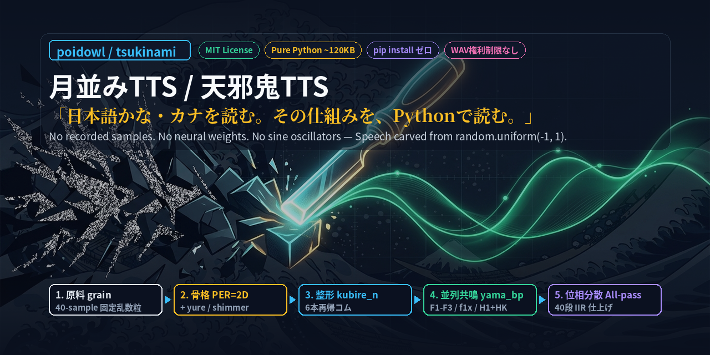

# Tsukinami TTS / Amanojaku TTS (`tsukinami`)



**[🇯🇵 日本語 (Japanese README)](README.md) | [🌐 English](README_EN.md)**

> **Read Japanese Kana.**  
> **Read how it works, in Python.**

### 👉 Try It Live in Your Browser (No Install — Mobile & Desktop)
- 🎛️ **[Interactive Toybox (`toybox.html`)](https://poidowl.github.io/tsukinami/toybox.html)** — 6 real `carve.py` character presets + one-click A/B compare + 10 magic-number sliders + Recipe JSON generator
- 🔬 **[6-Stage Carving & 17-Mora Microscope (`watashi_demo.html`)](https://poidowl.github.io/tsukinami/watashi_demo.html)** — Hear how *"Watashi, nihongo, chotto shaberemasu"* is carved from white noise
- 🧪 **[7-Track Ablation Jury (`ablation.html`)](https://poidowl.github.io/tsukinami/ablation.html)** — Disable each DSP component one by one and hear the exact difference
- 🎹 **[Free-Kana Web Synth (`demo.html`)](https://poidowl.github.io/tsukinami/demo.html)** — Type any Japanese kana and synthesize live in the browser

---

> **Don't draw the voice—create the conditions where a voice is born.**  
> **No recorded voice samples. No pre-trained neural weights. Carve a human voice out of uniform random noise.**

**Tsukinami TTS (`tsukinami`)** is a ~120 KB pure-Python Japanese speech & singing synthesizer that uses **zero recorded audio units** (no concatenative corpus), **zero neural network weights**, and **zero sine-wave oscillators (`math.sin`) or pre-made periodic waveforms** in its sound source. Stage 1 runs on the **Python 3 standard library alone** (`pip install` nothing) and uses no FFT when `henv=null` (the default Stage 1 preset).

- **Code License**: **MIT License** ([LICENSE](LICENSE)) — free for commercial/non-commercial use, modification, and redistribution.
- **Generated Audio (WAV) Rights**: **Zero restrictions** — no credit or attribution required for videos, streams, games, apps, or commercial works.
- **External Dependencies (Stage 1)**: **Zero** (`math`, `random`, `wave`, `struct`, `json`, `array`, `os` only; works on Windows, macOS, and Linux).

---

## Architecture (Code-Audited & Ablation-Verified)

```text
[One-time 40-sample Random grain] ──▶ [Periodic Placement (PER=2D + yure + shimmer)] ──▶ [kubire_n (Comb Shaping)] + [Unvoiced Hiss]
   (Fixed Spectrum = Voice DNA)              (Pitch Skeleton + Jitter/Shimmer)
                                                                                                   │
        ┌──────────────────┬──────────────────┬──────────────────┬─────────────────────────────────┤
        ▼                  ▼                  ▼                  ▼                                 ▼
  [Vowels F1/F2/F3]  [F1 Shoulder f1x]  [Fundamental H1+HK]   [F4 / F5]                   (Parallel Extraction)
        └──────────────────┴──────────────────┴──────────────────┴─────────────────────────────────┘
                                               │
                                               ▼ (Additive Mix)
                                [40-Stage All-Pass Cascade (Phase / Group-Delay Dispersion)]
```

### How It Works: The 5 Building Blocks ([`carve.py:994-1117`](carve.py#L994-L1117))

1. **Raw Material (Fixed-Spectrum Random `grain` — [`carve.py:995-999`](carve.py#L995-L999)):**
   A single 40-sample grain (~0.91 ms at 44.1 kHz) is carved once from `random.uniform(-1, 1)` via moving averages (`arakezuri`) and windowing (`kiridashi`), then reused across the utterance. Its fixed random spectrum acts as the "voice DNA." Replacing this 40-sample grain with a 2-sample dipole impulse (`[1, -1]`) causes a **16.59 dB** short-time spectral degradation (turning into a mechanical buzzer).
2. **Skeleton (`PER = 2D` + `yure` + `shimmer` — [`carve.py:976-1005`](carve.py#L976-L1005)):**
   The fixed `grain` is placed along the time axis at intervals `PER = 2D` dictated by the Tokyo pitch-accent contour ([`accent.py`](accent.py)), while injecting per-period interval jitter (`yure = 0.003`) and amplitude shimmer (`shimmer = 0.05`). Removing these micro-fluctuations causes a **10.51 dB** short-time spectral shift and a robotic tone.
3. **Harmonic Shaping (`kubire_n` — [`carve.py:92-102`](carve.py#L92-L102), [`1007-1009`](carve.py#L1007-L1009)):**
   A time-domain recursive $N$-comb filter (`K75: N=4, g=0.3` / `E77/E79/mkt.py: N=6, g=0.5`) refines the harmonic notches. Ablation shows that removing `kubire_n` (`line_g=0`) retains a **+0.9971 waveform correlation** (4.39 dB short-time LSD; 1.34 dB long-term band difference), demonstrating that periodic grain placement + parallel resonance extraction already establish most of the harmonic structure.
4. **Parallel Resonance Bank (`yama_bp` + `_agc` — [`carve.py:1038-1104`](carve.py#L1038-L1104)):**
   Rather than filtering in series, the excitation `src` (voiced line + unvoiced consonant hiss) is branched into **parallel time-domain band-pass extractors (`yama_bp`)**: spectral floor (`floor`), vowel formants ($F_1\text{–}F_3$), $F_1$ shoulder (`f1x`), fundamental $H_1$, low harmonics $H_K$ ($2H, 3H$), and high formants ($F_4, F_5$), each governed by short-time AGC (`_agc`) and summed into `mix`.
5. **Phase & Temporal Dispersion (40-Stage All-Pass `_ap_cascade` — [`carve.py:553-570`](carve.py#L553-L570), [`1109`](carve.py#L1109)):**
   Instead of cutting frequencies, 40 cascaded 2nd-order IIR all-pass sections (`|H(e^{j\omega})| = 1`) disperse phase and group delay across time. Utterance-wide magnitude spectrum changes by only **0.07 dB** (proving no frequency cutting occurs), while 20 ms short-time LSD shifts by **4.24 dB** ($r = -0.0838$) due to cross-frame group-delay dispersion.

---

## Ablation Study Results ([`ablation.html`](ablation.html))

Test utterance: `"わたし、にほんご、ちょっとしゃべれます"` (*"Watashi, nihongo, chotto shaberemasu"* — *"I can speak a little Japanese"*, 44.1 kHz, 4.355 s, `seed=2024`).

| Condition (Playable in [`ablation.html`](ablation.html)) | Waveform Corr $r$ | Short-Time LSD (20ms) | Long-Term Band Diff | Perceptual / Acoustic Effect |
|---|---:|---:|---:|---|
| **1. Baseline (Full Stage 1)** | `+1.0000` | `0.00 dB` | `0.00 dB` | Standard Stage 1 output |
| **2. Replace 40-sample `grain` with `[1,-1]` impulse** | `-0.6427` | **`16.59 dB`** | **`8.42 dB`** | Loses vocal timbre DNA; turns into a harsh buzz |
| **3. Remove all jitter/shimmer/drift (`yure=0`)** | `+0.1014` | **`10.51 dB`** | `1.89 dB` | Frozen phase trajectory; sounds stiff and robotic |
| **4. Remove Fundamental `H1` + Harmonics `HK` only** | `+0.9027` | **`5.11 dB`** | **`3.87 dB`** | Main contributor to vocal warmth/chest resonance |
| **5. Remove `F1` Shoulder (`f1x`) only** | `+0.9974` | **`1.02 dB`** | `0.55 dB` | Subtle ~1 dB (JND-level) filler for the $F_1\text{–}F_2$ valley |
| **6. Remove 6-comb `kubire_n` (`line_g=0`)** | **`+0.9971`** | `4.39 dB` | `1.34 dB` | Primary harmonic structure already formed by `PER=2D` |
| **7. Remove 40-stage All-Pass (`ap_n=0`)** | `-0.0838` | `4.24 dB` | **`0.07 dB`** | Long-term spectrum invariant (`0.07 dB`); disperses phase in time |

---

## Quickstart (Windows / macOS / Linux — Zero Dependencies)

Even if you don't have a Japanese keyboard, running [`yomu.py`](yomu.py) with no arguments synthesizes *"Watashi, nihongo, chotto shaberemasu"* (*"I can speak a little Japanese"*) out of the box:

```bash
# 1) Synthesize the default sentence ("Watashi, nihongo, chotto shaberemasu") -> out/yomu_1.wav
python yomu.py

# 2) Synthesize custom Japanese kana with optional accent (') / flat (0) / question (?) marks
python yomu.py "わたし0、にほんご0、ちょ'っと しゃべれま'す？" -o out/watashi_q.wav

# 3) Hack the 5 DSP blocks directly from the CLI
python yomu.py "わたし、にほんご、ちょっとしゃべれます" \
  --seed 7 \          # [1. Grain] Change the 40-sample random grain seed (voice DNA)
  --tsubu 40 \        # [1. Grain] Grain length in samples
  --hz 240 \          # [2. Skeleton] Base pitch register (Hz)
  --yure 0.003 \      # [2. Skeleton] Period placement jitter
  --line-g 0.0 \      # [3. Shaping] Bypass 6-comb kubire_n (set g=0.0)
  --fscale 1.0 \      # [4. Resonance] Vocal tract scale (1.22 = child/short, 1.0 = adult)
  --ap-n 0 \          # [5. Phase] Bypass 40-stage all-pass cascade
  -o out/hack.wav
```

### Interactive Browser Demos (No Python Needed)

Open any of these self-contained HTML files directly in your browser (zero external CDN requests):
1. **[`toybox.html`](toybox.html)**: "Breakable & Reversible" Toybox with 6 real `carve.py` character presets (`default`, `ossan`, `robot`, `horror`, `whisper`, `chibi`), one-click A/B comparison, 10 magic-number sliders, and Recipe JSON / CLI generator.
2. **[`watashi_demo.html`](watashi_demo.html)**: 6-stage real `carve.py` audio evolution tour + 17-mora microscope + 7-track ablation comparison.
3. **[`ablation.html`](ablation.html)**: 7-track ablation listening jury & quantitative metric formulas.
4. **[`demo.html`](demo.html)**: Live Web Audio kana-to-speech playground with code-line sliders.

---

## Why ~765 Numbers Are Enough: Problem Scoping & Acoustic Cues

> **Rather than solving "reproduce the human voice in its entirety," Tsukinami TTS narrows the problem to: "generate the acoustic cues needed for a listener (and ASR) to recognize Japanese speech from a kana sequence."**

1. **Kana Input + Textbook Phonetics + ASR Selection ([`kotoba.py:1-76`](kotoba.py#L1-L76), [`accent.py:1-26`](accent.py#L1-L26) — `187` numbers):**
   Using kana input bypasses kanji G2P ambiguity and anchors vowel targets to `5 vowels × 3 formants = 15` values (`VT`), while explicitly modeling consonant place/manner, $F_2$ locus equations (`LE`), consonant durations (`CDUR`), nasals (`nasT`), geminate/moraic nasal timing, devoicing attenuation, and fricative bands (`fricT`) — tuned by owner ear + ASR ([`kotoba.py:5`](kotoba.py#L5)).
2. **Multi-Stage Source Shaping from a 40-Sample Random Grain ([`carve.py:985-1027`](carve.py#L985-L1027)):**
   A simple 40-sample fixed random grain is shaped step by step via periodic placement (`PER = 2D`), period jitter (`yure = 0.003`), per-grain amplitude shimmer (`±5%`), slow pitch drift (`tadayoi`), 6-comb harmonic shaping (`kubire_n`), and voiced/unvoiced mixing before entering the resonance bank.
3. **Parallel Resonance Extraction & 40-Stage All-Pass Dispersion ([`carve.py:1038-1109`](carve.py#L1038-L1109) — `231` recipe + `347` literal numbers):**
   Following the cascade/parallel formant synthesis tradition (Klatt, 1980), `carve.py` branches a shared excitation `src` into parallel moving-average band-pass extractors (`yama_bp`) for `floor`, $F_1\text{–}F_3$, `f1x`, $H_1/H_K$, and $F_4\text{–}F_5$, sums them, and applies 40 all-pass stages (`_ap_cascade`) for temporal phase dispersion.

### 📚 Prior Art (Classical Phonetics & DSP) vs. Original Contributions

All code in this repository is written from scratch in pure Python standard library. To make the conceptual lineage completely transparent, here is the exact boundary between classical literature and Tsukinami's original design:

| Category | Component | Code Location | Lineage / Details |
|---|---|---|---|
| **📚 Prior Art / Classical Literature** | Cascade/parallel formant synthesis architecture & vowel/consonant targets | [`kotoba.py:53-76`](kotoba.py#L53-L76)<br>[`carve.py:1038-1100`](carve.py#L1038-L1100) | Dennis H. Klatt (1980), *"Software for a cascade/parallel formant synthesizer"*, JASA 67(3), pp. 971–995. |
| **📚 Prior Art / Classical Literature** | Consonant-to-vowel $F_2$ locus equations (`LE`) | [`kotoba.py:67, 174`](kotoba.py#L67) | Björn Lindblom (1963) / Harvey M. Sussman et al. (1991), *JASA* 90(3). |
| **📚 Prior Art / Classical Literature** | Rule-based Tokyo pitch accent, downstep, and declination | [`accent.py:9-26`](accent.py#L9-L26) | Janet Pierrehumbert & Mary E. Beckman (1988), *"Japanese Tone Structure"*, MIT Press / Fujisaki model. |
| **📚 Prior Art / Classical Literature** | Spectral envelope Gaussian bump energy model (`_world_energy`) | [`carve.py:495-517`](carve.py#L495-L517) | Masanori Morise et al. (2016), *"WORLD: A Vocoder-Based High-Quality Speech Synthesis System"*, IEICE Trans. |
| **📚 Prior Art / Classical Literature** | 2nd-order Biquad All-Pass phase/group-delay dispersion (`_ap_cascade`) | [`carve.py:553-570`](carve.py#L553-L570) | Classical DSP 2nd-order IIR all-pass cascade (40 stages). |
| **🪵 Original to Tsukinami** | **Single 40-sample fixed random `grain` ("potato stamp") + jittered periodic stamping** | [`carve.py:995-1005`](carve.py#L995-L1005) | Instead of oscillators or impulse trains, one 40-sample carved noise grain serves as the fixed spectral DNA, stamped every `PER = 2D` with `yure` and `shimmer`. |
| **🪵 Original to Tsukinami** | **Time-domain moving-average subtraction & bidirectional comb chisels (`arakezuri`, `kubire_n`, `yama_bp`)** | [`carve.py:18-145`](carve.py#L18-L145) | Formant extraction and harmonic shaping built from moving-average subtraction and $N$-comb feedback. |
| **🪵 Original to Tsukinami** | **Noise-carved singing vibrato (`uta_vib`) without `math.sin()`** | [`carve.py:961-973`](carve.py#L961-L973) | Even the vibrato LFO is carved from white noise via comb filtering and moving averages rather than a sine function. |
| **🪵 Original to Tsukinami** | **Human ear onomatopoeia + ASR loop condensed into 120KB stdlib Python & Toybox** | [`kotoba.py:225-245`](kotoba.py#L225-L245)<br>[`yomu.py`](yomu.py), [`toybox.html`](toybox.html) | Interactive "Play → Modify → Listen → Compare → Share" workflow in ~765 transparent numbers. |
